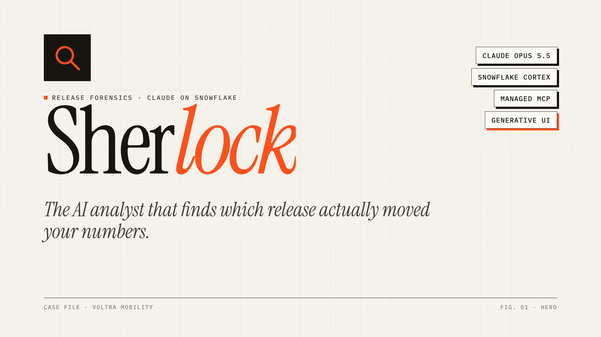
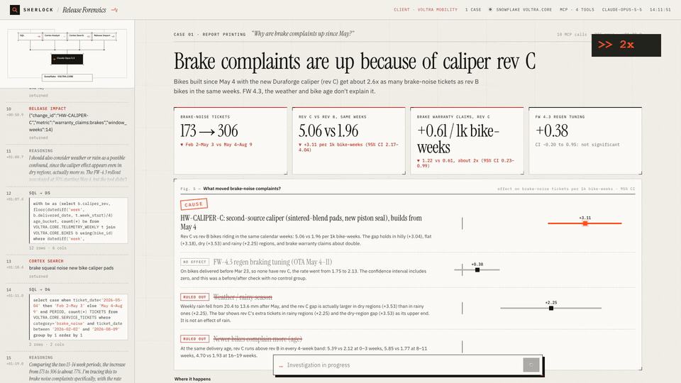
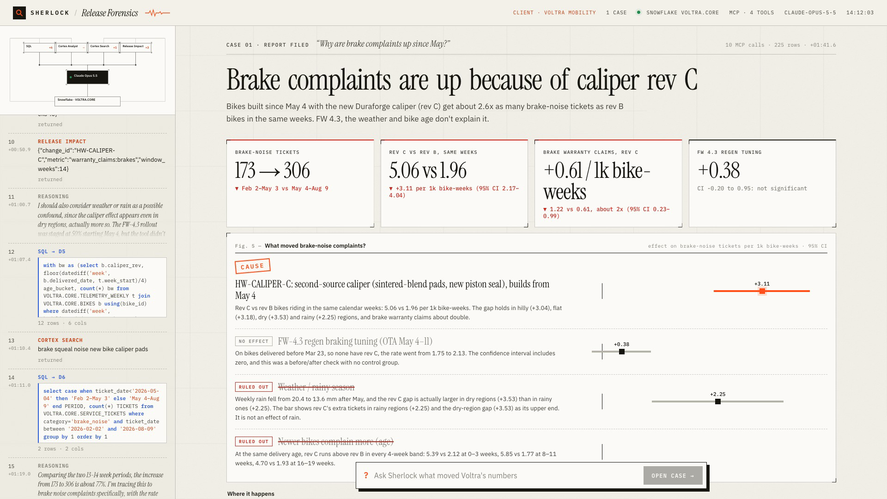
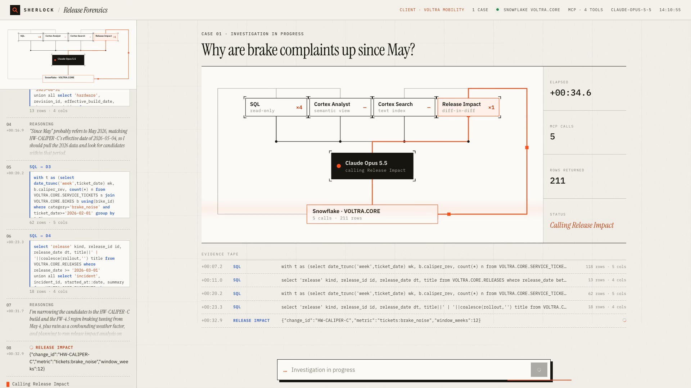
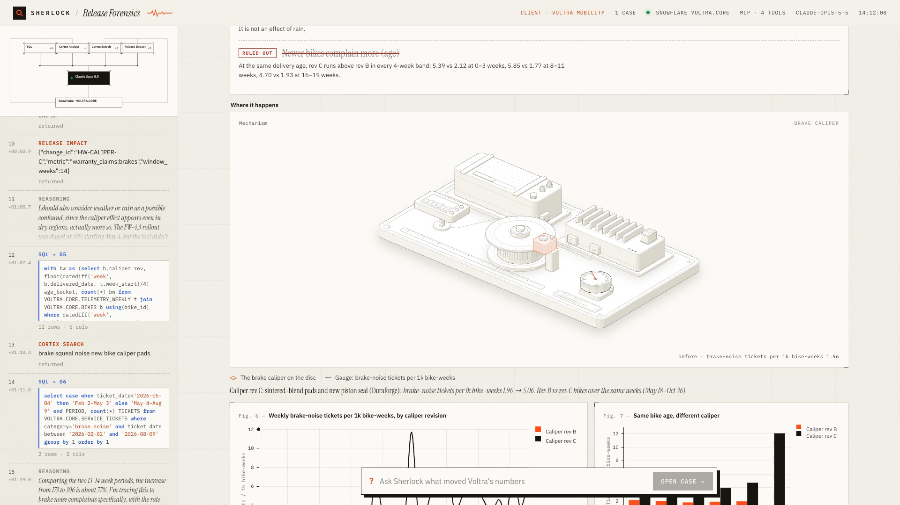
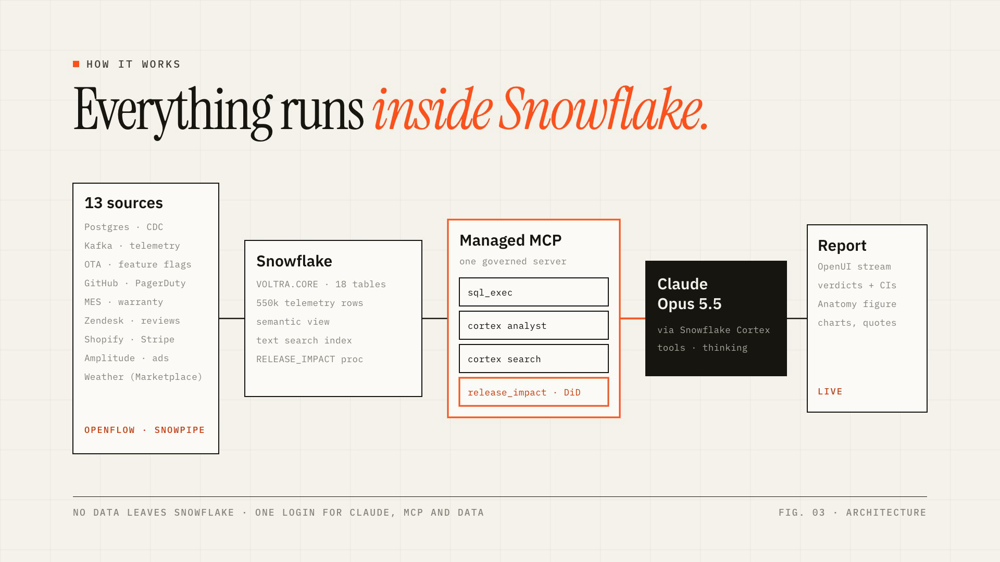

<div align="center">



# Sherlock

### The AI analyst that finds which release actually moved your numbers.

**Claude Opus 5.5 · Snowflake Cortex · Managed MCP · Generative UI**


[**▶ Watch the 60-second demo**](docs/video/sherlock-demo-60s.mp4) · [How it works](#how-it-works) · [Quickstart](#quickstart) · [Sample cases](#sample-cases)



</div>

---

## Why Sherlock?

Every metric change has a dozen suspects. On May 4, Voltra shipped a new brake caliper from a second supplier **and** pushed firmware 4.3 with new regen-braking logic, in the rainy season, alongside an app release. Two weeks later brake complaints tripled.

A dashboard tells you **what** changed. It can't tell you **why**, because the evidence lives in 13 different systems: device telemetry, OTA logs, feature flags, GitHub, manufacturing, warranty, Zendesk, app reviews, Shopify, Stripe, Amplitude and more.

Sherlock does the investigation a senior analyst would do, in about 90 seconds:

1. **Quantifies** the change and when it started.
2. **Lists every suspect** that shipped in that window: software releases, hardware revisions, incidents, campaigns and seasonality.
3. **Tests each one against a control cohort.** Staged rollouts, flag holdouts, build revisions and incident-affected users each become a natural experiment, and a diff-in-diff runs **inside Snowflake**.
4. **Files a report.** It names the cause with an effect size and a 95% CI, crosses out the decoys with the evidence that clears them, and shows *where* in the product it happened.



## What makes it different

| | |
|---|---|
| **Causal, not descriptive** | Every candidate is tested against a control group (`RELEASE_IMPACT`, a Python stored procedure). Concurrent changes within ±7 days are flagged automatically, so coincidences don't become causes. |
| **Everything runs inside Snowflake** | Claude Opus 5.5 is served by Snowflake Cortex through its Anthropic-compatible Messages API. Tools come from a **Snowflake-managed MCP server**. One Snowflake login covers the model, the tools and the data, and no data leaves the account. |
| **Generative UI that streams** | Claude writes the report in **OpenUI Lang**, and the dashboard builds itself token by token: verdict board, KPIs, charts, quotes and caveats. No pre-built dashboards. |
| **Shows where it happened** | The `Mechanism` card is a live isometric **Anatomy** figure of the product on a dyno bench. It lights the subsystem that caused the change and animates the metric from before to after, using the query results. |
| **Evals with a planted answer key** | The demo company's data has six **planted** causes and same-week decoys, and `evals/run_evals.py` scores whether Sherlock finds them. |

<table>
<tr>
<td width="50%"></td>
<td width="50%"></td>
</tr>
<tr>
<td align="center"><b>Live investigation</b>: every MCP call is visible as it happens</td>
<td align="center"><b>Mechanism</b>: the lit subsystem is the cause</td>
</tr>
</table>

## How it works



```
Browser (React 19 · OpenUI · Motion · Anatomy) ──SSE── FastAPI agent loop
   ├─ Claude Opus 5.5 ── Snowflake Cortex, Anthropic-compatible Messages API (/api/v2/cortex/v1/messages)
   └─ Tools ── Snowflake-managed MCP server VOLTRA.CORE.VOLTRA_MCP (discovered via MCP tools/list)
        sql_exec         read-only SQL over 18 tables
        voltra_analyst   Cortex Analyst on the VOLTRA_360 semantic view (official metric definitions)
        voltra_search    Cortex Search over tickets, reviews, release notes, postmortems, change orders
        release_impact   diff-in-diff stored procedure → effect, 95% CI, n, concurrent events
```

| Layer | What it does |
|---|---|
| **SQL** | Gets the numbers. Results stream to the browser and become the charts. |
| **Cortex Analyst** | Makes sure metrics match the company's official definitions. |
| **Cortex Search** | Finds the human evidence: what customers, engineers and postmortems actually say. |
| **Release Impact** | Proves cause and effect by comparing treated and control cohorts over the same weeks. |

### The demo company: Voltra Mobility

Voltra is a **fictional connected e-bike company** with software, mechanical hardware and a subscription business. Its data is generated with a fixed seed (`data/voltra/generate.py`) into 18 Snowflake tables (13k bikes, 550k bike-weeks of telemetry), each mirroring a system a real company would land in Snowflake:

| Source system (in production) | Tables |
|---|---|
| Bike IoT telemetry via Kafka / Snowpipe Streaming | `TELEMETRY_WEEKLY`, `ERROR_EVENTS` |
| OTA firmware service · feature flags (Postgres, LaunchDarkly) | `FIRMWARE_INSTALLS`, `FLAG_EXPOSURES` |
| GitHub releases · PagerDuty incidents | `RELEASES`, `INCIDENTS` |
| MES / PLM / ERP | `BIKES`, `HARDWARE_REVISIONS`, `WARRANTY_CLAIMS` |
| Zendesk · App Store / Google Play | `SERVICE_TICKETS`, `APP_REVIEWS` |
| Shopify · Stripe · Amplitude · ad platforms | `ORDERS`, `CUSTOMERS`, `SUBSCRIPTIONS`, `WEB_FUNNEL_DAILY`, `MARKETING_SPEND` |
| Snowflake Marketplace | `WEATHER_WEEKLY` |

## Sample cases

Each case has a planted ground truth and at least one decoy that shipped in the same week.

| Ask Sherlock | The truth | The decoy it must rule out |
|---|---|---|
| *Why are brake complaints up since May?* | **Caliper Rev C** (supplier change): about 2.6× brake-noise tickets, 2× brake claims | FW 4.3 regen tuning, same day; spring rain |
| *What caused the drop in battery warranty costs last autumn?* | **FW 4.2 thermal management**: battery 6°C cooler, claims −60% | Autumn cooling |
| *Did the app 5.0 checkout redesign lift sales?* | **No.** The A/B test is flat; the **Spring Into Motion** campaign and seasonality drove orders | The redesign itself |
| *Why did Voltra Care cancellations spike in August?* | **INC-217** unlock outage: 10.6% vs 1.5% cancellation among affected riders | App 5.2, same day |
| *Did Hill Assist increase riding?* | **Only in hilly regions**: +11.5% rides, fewer cancellations | Fleet-wide average (looks flat) |
| *Is the cheaper M2 motor safe to keep?* | **Yes.** No reliability change, saves $18 per bike | — |

## Quickstart

**Requirements:** a Snowflake account with Cortex access (Claude Opus 5.5), Python 3.12, Node 20+ and [uv](https://github.com/astral-sh/uv).

```bash
git clone https://github.com/KaushikSiva/sherlock && cd sherlock
uv venv .venv && uv pip install -r requirements.txt
cp .env.example .env                                        # SNOWFLAKE_ACCOUNT / USER / PASSWORD

# 1. Build and load the demo company (about 1 minute)
.venv/bin/python data/voltra/generate.py
.venv/bin/python data/voltra/load.py
.venv/bin/python sql/run_sql.py sql/voltra_setup.sql        # semantic view, search, RELEASE_IMPACT, MCP server

# 2. Build the UI
cd web && OPENUI_TELEMETRY_DISABLED=1 npm install --ignore-scripts && npm run build && cd ..

# 3. Run
.venv/bin/uvicorn app:app --port 8420                       # → http://localhost:8420
```

Optional settings (`.env`): `CLAUDE_MODEL` (default `claude-opus-5-5`), `CLAUDE_EFFORT` (default `medium`), `DEFAULT_DATASET` (default `voltra`).

### Evals

```bash
.venv/bin/python evals/run_evals.py          # runs every planted case and grades cause · decoys · effect size
```

Each run spends Cortex credits: about 6 cases at 1–2 minutes each, plus grading.

## Project layout

```
agent.py                  agent loop: Claude via Cortex + Snowflake MCP client + streaming events
app.py                    FastAPI: /api/ask (SSE), /api/config, /api/stats
data/voltra/              synthetic company generator + loader (fixed seed, planted effects)
sql/                      semantic view, Cortex Search, RELEASE_IMPACT procedure, MCP servers
evals/                    planted answer key + LLM-graded eval runner
web/src/openui/           OpenUI component library (Dashboard, Kpi, Chart, Verdicts, Mechanism, …)
web/src/iso/voltra/       Anatomy figure: dyno bench model, geometry, live component
web/src/AgentFlow.tsx     live agent schematic
demo/                     intro slides, recorder, editor and face-cam compositor for the demo video
```

## Built with

- **[Claude Opus 5.5](https://www.anthropic.com/claude)** on **[Snowflake Cortex](https://www.snowflake.com/en/product/features/cortex/)**: tool use with adaptive thinking.
- **[Snowflake-managed MCP server](https://docs.snowflake.com/)**: Cortex Analyst, Cortex Search, SQL and a custom stored-procedure tool.
- **[OpenUI](https://github.com/thesysdev/openui)**: streaming generative UI (OpenUI Lang).
- **[Anatomy](https://github.com/wheresryan22/anatomy)** (MIT): isometric figure kit. The `Mechanism` bench was built with its workflow and passes its line-end checks.
- **Vega-Lite**, **Motion**, **React 19**, **FastAPI**.

## Disclaimer

Voltra Mobility is fictional and all of its data is synthetic. The effects in it were planted on purpose so Sherlock's answers can be checked against a known truth. Point the same MCP server at your own Snowflake data to investigate real releases.

## License

[MIT](LICENSE)

---

<div align="center">

**If Sherlock solved a case for you, give it a ⭐. It helps others find it.**

</div>
